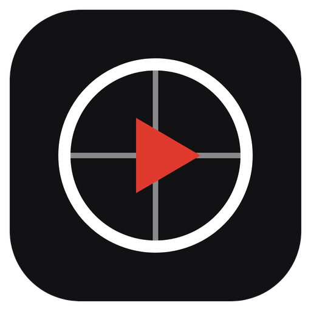

<table border="0">
  <tr>
    <td valign="middle">
      
    </td>
    <td valign="middle">
      <h1>NBA Watch Tracker</h1>
      
      
      
    </td>
  </tr>
</table>

NBA Watch Tracker is where you log the games you've watched and keep a running record of your season. Scores stay hidden until you reveal them, so you can catch up spoiler free, and every game shows in your own time zone. Each finished game also gets a Hype score for how good it was to watch, so you know which nights are worth going back for without anything being given away. Your stats and badges build up as you go, and a fan leaderboard is on the way. It's a record of your season as a fan, the games, the teams, the nights you'll want to remember.

## License

MIT, see [LICENSE](LICENSE).
